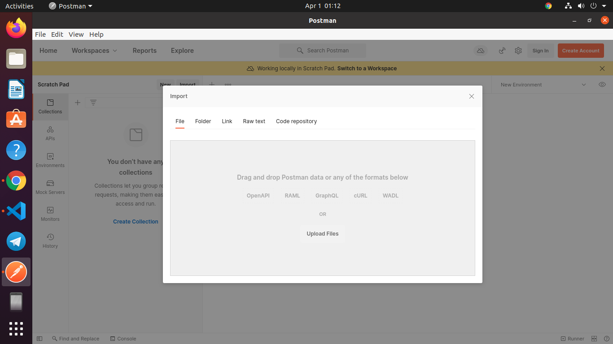
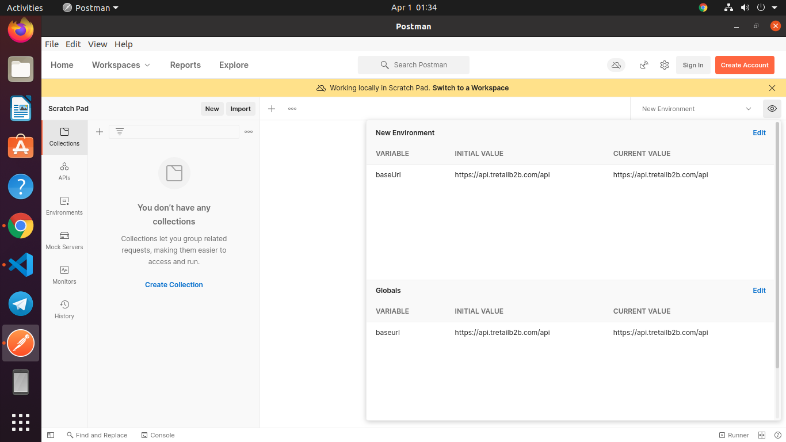
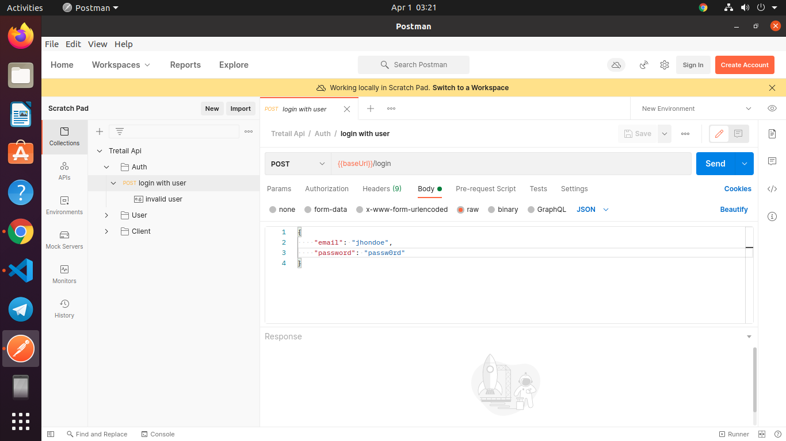
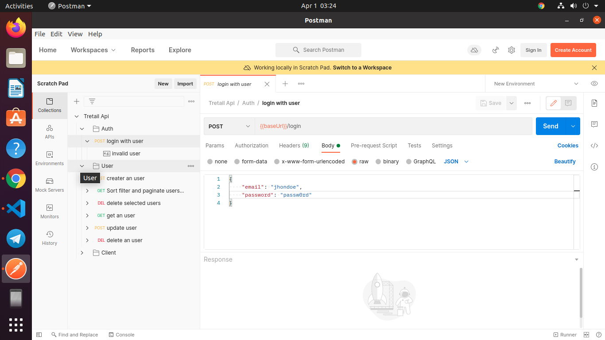

# Tretail OpenAPI 3.0 definations
Test and understand about Tretail Api with this OpenAPI version 3.0.0 specification  written 
in .yaml format and postman app.


## Prerequisites

#### 1.  Postman.

Install postman version 8.0.0 or greater.
you can download form here [here](https://www.postman.com/downloads/).

#### 2.  Nodejs

Check if you have nodejs installed in you system by this command.

```node -v```

If this command don't show the nodejs version. install nodejs in your system.
You can download nodejs from [here](https://nodejs.org/en/download)

#### 3.  speccy.

Create single OpenAPI specification .yaml file with 'speccy' node module.
First to install speccy node modules by this command.

```npm install -g speccy```

 Check if you have intalled speccy node module successfuly by this command.

```speccy --version```

Create single OpenAPI specification file with this command

```speccy resolve main.yaml -o spec.yaml```

Here spec.yaml is the output file name that will be create after running above command.


## Getting started

### 1.  Import OAS 3.0 definations into postman.

 Click on 'import' option and upload 'spec.yaml' from this screen.
  
 


 Check few Advanced settings by clicking 'show Advanced settings' option from this window.
 Make sure
 *  'Request parameter generation' option selected to 'Example'
 *  'Response parameter generation' option selected to 'Example'
 *  'Folder organization' option selected 'Tags'
 then click on import. Here you can see in the collection tab to the left side all Endpoints imported as folders and subfolders.

### 2.  Set environment in postman.

 Click on 'quick look'(eye) button right side of 'select environment option' like this.
 
 

 From 'edit' option from here add a variable 'baseUrl' and it's value.Then give name of the environment. Activate the environment by selecting 'environment' tab from left side of postman
 and check the environment you created.

### 3.  Login endpoint.

To login Tretail api select login endpoint from Tretail folder's  collection tab.
From body tab you can see example request body. After edit this example and send post request.
postman app store all the response cookies after successful login.



### 4.  Check All the endpoints.

From collection tab The Api created all dropdown folders by tags. All endpoints related to
this tags created dropdown under this specific tag folder. By open dropdowns of a endpoint
all the responses status and examples can be seen.



 
## Resources

### 1.  Learn About OpenAPI V3.0 Specification

<https://swagger.io/docs/specification/about>

### 2.  Postman Documentaion.

<https://learning.postman.com/docs/getting-started/introduction/>

### 3.  Speccy node module github.

<https://github.com/wework/speccy>


 
  


